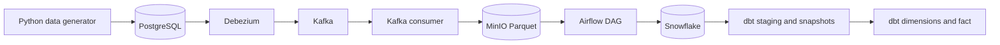

# Banking CDC and Analytics Pipeline

A learning project for following synthetic banking data from a PostgreSQL
transactional database through change data capture (CDC), object storage,
orchestration, and Snowflake/dbt analytics.

> **Project status:** prototype. The repository contains the main components,
> but a complete run requires local configuration and Snowflake setup. Known
> integration gaps are listed below; this is not a production-ready banking
> system.

## What this project does

1. Generates synthetic customers, accounts, and transactions with Faker.
2. Uses Debezium to capture PostgreSQL changes and publish them to Kafka.
3. Consumes Kafka records and writes batches as Parquet files to MinIO.
4. Uses Airflow to transfer MinIO files to Snowflake.
5. Uses dbt staging models, snapshots, dimensions, and a transaction fact model
   to shape warehouse data.



## Repository map

| Path | Purpose |
| --- | --- |
| `postgres/schema.sql` | PostgreSQL source tables and transaction index |
| `data-generator/faker_generator.py` | Synthetic source data generator |
| `kafka-debezium/generate_and_post_connector.py` | Registers the PostgreSQL Debezium connector |
| `consumer/kafka_to_minio.py` | Consumes Kafka topics and writes Parquet to MinIO |
| `docker-compose.yml` | Local PostgreSQL, Zookeeper/Kafka, Debezium Connect, MinIO, and Airflow services |
| `docker/dags/minio_to_snowflake_dag.py` | Transfers MinIO objects to Snowflake |
| `docker/dags/scd_snapshots.py` | Runs dbt snapshots and marts on a schedule |
| `banking_dbt/models/staging/` | Parses and shapes raw source data |
| `banking_dbt/models/marts/` | Customer/account dimensions and transaction fact |
| `banking_dbt/snapshots/` | Account and customer history snapshots |
| `.github/workflows/` | CI and dbt workflow definitions |

## Prerequisites

- Docker Desktop with Docker Compose
- Python 3.11 recommended
- A Snowflake account, warehouse, database, and schema if running the warehouse
  steps

## Configuration

Configuration files containing credentials are intentionally not committed.
Create the ignored `.env` files locally; do not put real passwords in source
control.

The root `.env` is used by Docker Compose and needs:

```text
POSTGRES_USER
POSTGRES_PASSWORD
POSTGRES_DB
MINIO_ROOT_USER
MINIO_ROOT_PASSWORD
AIRFLOW_DB_USER
AIRFLOW_DB_PASSWORD
AIRFLOW_DB_NAME
```

The Python programs and Airflow DAG also call `load_dotenv()`. Supply their
settings in the `.env` alongside each program (or in the mounted
`docker/dags/.env` for Airflow):

| Component | Required settings |
| --- | --- |
| Data generator | `POSTGRES_HOST`, `POSTGRES_PORT`, `POSTGRES_DB`, `POSTGRES_USER`, `POSTGRES_PASSWORD` |
| Debezium registration script | The same `POSTGRES_*` settings; use `POSTGRES_HOST=postgres` from the Docker network |
| Kafka consumer | `KAFKA_BOOTSTRAP`, `KAFKA_GROUP`, `MINIO_ENDPOINT`, `MINIO_ACCESS_KEY`, `MINIO_SECRET_KEY`, `MINIO_BUCKET` |
| MinIO-to-Snowflake DAG | `MINIO_ENDPOINT`, `MINIO_ACCESS_KEY`, `MINIO_SECRET_KEY`, `MINIO_BUCKET`, `SNOWFLAKE_USER`, `SNOWFLAKE_PASSWORD`, `SNOWFLAKE_ACCOUNT`, `SNOWFLAKE_WAREHOUSE`, `SNOWFLAKE_DB`, `SNOWFLAKE_SCHEMA` |

For programs run on the Windows host, use host addresses such as
`POSTGRES_HOST=localhost`, `KAFKA_BOOTSTRAP=localhost:29092`, and
`MINIO_ENDPOINT=http://localhost:9000`. For services running inside Compose,
use service names such as `postgres`, `kafka`, and `http://minio:9000`.
`POSTGRES_HOST` therefore differs between the host-run generator and the
Debezium connector running in Docker.

The dbt commands need a dbt profile at `banking_dbt/.dbt/profiles.yml`; this
directory is mounted into Airflow as `/home/airflow/.dbt`. Configure a
`banking_dbt` profile using the dbt Snowflake adapter and credentials for your
own Snowflake account. The dbt source declaration currently targets
`BANKING.RAW`.

## Run locally

The steps below assume you have prepared the configuration above.

1. Start the supporting services:

   ```powershell
   docker compose up -d --build
   ```

2. Create the PostgreSQL tables from the repository schema:

   ```powershell
   docker compose cp .\postgres\schema.sql postgres:/tmp/schema.sql
   docker compose exec postgres sh -c 'psql -U "$POSTGRES_USER" -d "$POSTGRES_DB" -f /tmp/schema.sql'
   ```

3. Install the Python dependencies on the host:

   ```powershell
   python -m venv .venv
   .\.venv\Scripts\Activate.ps1
   python -m pip install -r requirements.txt
   ```

4. Register the Debezium connector after Kafka Connect is ready:

   ```powershell
   python .\kafka-debezium\generate_and_post_connector.py
   ```

5. Start the data generator. It runs continuously by default; `--once` makes
   one batch and exits:

   ```powershell
   python .\data-generator\faker_generator.py --once
   ```

6. Start the consumer in another terminal. It continues listening and uploads
   each full batch to MinIO:

   ```powershell
   python .\consumer\kafka_to_minio.py
   ```

7. Configure the Snowflake objects and dbt profile, then enable the Airflow
   DAGs from the Airflow UI at `http://localhost:8080`. The MinIO transfer DAG
   is scheduled every minute; the snapshots DAG is scheduled daily.

The generator, connector-registration script, and consumer are separate
processes and are not launched by `docker compose up`. The Snowflake objects
expected by the ingestion DAG must exist before its load step can succeed.

## Data models

- `stg_customers` and `stg_accounts` extract fields from raw records and rank
  rows by entity ID and source `created_at`.
- `stg_transactions` shapes transaction fields.
- `customers_snapshot` tracks changes to names and email.
- `accounts_snapshot` tracks changes to customer, account type, and balance.
- `dim_customers` and `dim_accounts` expose snapshot validity periods.
- `fact_transactions` joins transactions to accounts and carries the related
  customer ID.

## Current limitations to resolve

- The consumer writes Parquet records with top-level fields, while the dbt
  staging SQL reads fields from a `v` VARIANT column. The Snowflake load step
  does not currently transform the Parquet rows into that shape. Align the
  raw-table schema, Snowflake `COPY` operation, and staging models before
  expecting dbt models to run successfully.
- The repository does not include Snowflake DDL for the raw tables or a dbt
  profile. Those must be supplied for a real warehouse run.
- The consumer writes a file only after a topic reaches its batch size. A
  partial batch remains in memory until more records arrive; delete events are
  not handled as row changes.
- The MinIO transfer DAG scans existing objects repeatedly. Validate load
  history, retention, and duplicate handling for your Snowflake setup before
  relying on scheduled runs.
- The CI workflow refers to a `tests/` directory that is not present in this
  repository. The CD workflow runs dbt against Snowflake; it does not deploy
  the Airflow services.
- The synthetic generator is for demonstrations only. It does not implement
  banking controls, transaction settlement, or production-grade data
  validation.

## Attribution and license

This is my working version of the pipeline, maintained by **Subhajit
Chowdhury**. The project direction was inspired by **Jaya Chandra Kadiveti**;
I appreciate the ideas that helped inform this work. See
[Jaya's profile](https://www.linkedin.com/in/jayachandrakadiveti/) for the
inspiration reference. This repository is not an official project or
endorsement by Jaya.

The repository includes an MIT license. If you reuse any third-party material,
retain its applicable copyright and license notices as required by its
original license.
