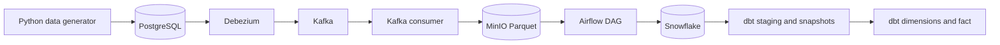

# Real-Time End-to-End Data Pipeline Using Kafka, Airflow, dbt, and Snowflake

This repository is a **synthetic-data portfolio prototype** for a banking
analytics pipeline. It contains PostgreSQL, Debezium, Kafka, a Python
consumer, MinIO, Airflow, Snowflake, and dbt components.

> **Accuracy note:** The repository describes a realistic pipeline pattern,
> but it is not a replica of a bank's production system. The components have
> not been verified as a working end-to-end pipeline. The blockers below are
> part of the current implementation.

## Project summary (STAR)

- **Situation:** Demonstrate how synthetic customer, account, and transaction
  records could move from an OLTP database toward analytics models.
- **Task:** Define the source, CDC, object-storage, orchestration, warehouse,
  and transformation components for that flow.
- **Action:** The code defines a Faker generator and PostgreSQL schema; a
  Debezium PostgreSQL connector and Kafka topics; a Python consumer configured
  to batch records into Parquet files in MinIO; Airflow DAGs for Snowflake
  loading and dbt runs; and dbt staging models, snapshots, dimensions, and a
  transaction fact model.
- **Result:** The repository contains these components and workflow
  definitions, but a successful end-to-end run is **not established**. The
  Kafka event format and the Snowflake/dbt input schema do not currently
  align, as detailed under [Known gaps](#known-gaps).

## Components and technologies

| Component | Technology | What the repository configures |
| --- | --- | --- |
| Synthetic source data | Python, Faker | Inserts customers, accounts, and transactions into PostgreSQL |
| Source database | PostgreSQL 15 | Relational tables; Compose enables logical WAL for CDC |
| Change capture | Debezium PostgreSQL connector | Connector config selects the three public tables and uses `pgoutput` |
| Event transport | Apache Kafka, Kafka Connect | Topics receive Debezium change events |
| Object storage | MinIO | Consumer code writes Parquet batches to an S3-compatible bucket |
| Orchestration | Apache Airflow | DAG code schedules MinIO loading every minute and dbt work daily |
| Warehouse | Snowflake | DAG code uses `PUT` and `COPY INTO` to load table stages |
| Transformations | dbt Core, Snowflake adapter | SQL defines staging views, customer/account snapshots, dimensions, and a fact model |
| Local infrastructure | Docker Compose | Declares PostgreSQL, Zookeeper, Kafka, Kafka Connect, MinIO, and Airflow services |
| Workflow automation | GitHub Actions | Defines lint/dbt compile and Snowflake dbt run/test workflows |

Supporting Python packages include `psycopg2-binary`, `kafka-python`,
`boto3`, `pandas`, `fastparquet`, `python-dotenv`, and `dbt-snowflake`.

## Recruiter and interview points

- **Project scope:** A prototype demonstrating the configuration and code for
  a CDC-to-warehouse path, not a verified production implementation.
- **Data modeling:** The dbt project defines staging views, check-strategy
  snapshots for customers and accounts, two dimensions, and an incremental
  transaction fact model.
- **Useful discussion:** Explain the intended data flow, then discuss the
  event-format and raw-schema mismatches, batch flushing, delete handling,
  load idempotency, and what you would change before production.
- **Resume wording:** “Created a synthetic banking-data pipeline prototype
  with PostgreSQL, Debezium, Kafka, MinIO, Airflow, Snowflake, and dbt; defined
  CDC, orchestration, snapshot, dimension, and fact-model components.”

Do not claim production use, successful end-to-end execution, performance
metrics, or business impact unless you have independently tested and measured
them.

## Intended data flow

The diagram shows the intended design, not a verified successful run:



## Repository map

| Path | Purpose |
| --- | --- |
| `postgres/schema.sql` | PostgreSQL source tables and transaction index |
| `data-generator/faker_generator.py` | Synthetic source data generator |
| `kafka-debezium/generate_and_post_connector.py` | Registers the PostgreSQL Debezium connector |
| `consumer/kafka_to_minio.py` | Consumes Kafka topics and writes Parquet to MinIO |
| `docker-compose.yml` | Local PostgreSQL, Zookeeper/Kafka, Debezium Connect, MinIO, and Airflow services |
| `docker/dags/minio_to_snowflake_dag.py` | Transfers MinIO objects to Snowflake |
| `docker/dags/scd_snapshots.py` | Runs dbt snapshots and marts on a schedule |
| `banking_dbt/models/staging/` | Parses and shapes raw source data |
| `banking_dbt/models/marts/` | Customer/account dimensions and transaction fact |
| `banking_dbt/snapshots/` | Account and customer history snapshots |
| `.github/workflows/` | CI and dbt workflow definitions |

## Prerequisites

- Docker Desktop with Docker Compose
- Python 3.11 recommended
- A Snowflake account, warehouse, database, and schema if running the warehouse
  steps

## Configuration

Configuration files containing credentials are intentionally not committed.
Create the ignored `.env` files locally; do not put real passwords in source
control.

The root `.env` is used by Docker Compose and needs:

```text
POSTGRES_USER
POSTGRES_PASSWORD
POSTGRES_DB
MINIO_ROOT_USER
MINIO_ROOT_PASSWORD
AIRFLOW_DB_USER
AIRFLOW_DB_PASSWORD
AIRFLOW_DB_NAME
```

The Python programs and Airflow DAG also call `load_dotenv()`. Supply their
settings in the `.env` alongside each program (or in the mounted
`docker/dags/.env` for Airflow):

| Component | Required settings |
| --- | --- |
| Data generator | `POSTGRES_HOST`, `POSTGRES_PORT`, `POSTGRES_DB`, `POSTGRES_USER`, `POSTGRES_PASSWORD` |
| Debezium registration script | The same `POSTGRES_*` settings; use `POSTGRES_HOST=postgres` from the Docker network |
| Kafka consumer | `KAFKA_BOOTSTRAP`, `KAFKA_GROUP`, `MINIO_ENDPOINT`, `MINIO_ACCESS_KEY`, `MINIO_SECRET_KEY`, `MINIO_BUCKET` |
| MinIO-to-Snowflake DAG | `MINIO_ENDPOINT`, `MINIO_ACCESS_KEY`, `MINIO_SECRET_KEY`, `MINIO_BUCKET`, `SNOWFLAKE_USER`, `SNOWFLAKE_PASSWORD`, `SNOWFLAKE_ACCOUNT`, `SNOWFLAKE_WAREHOUSE`, `SNOWFLAKE_DB`, `SNOWFLAKE_SCHEMA` |

For programs run on the Windows host, use host addresses such as
`POSTGRES_HOST=localhost`, `KAFKA_BOOTSTRAP=localhost:29092`, and
`MINIO_ENDPOINT=http://localhost:9000`. For services running inside Compose,
use service names such as `postgres`, `kafka`, and `http://minio:9000`.
`POSTGRES_HOST` therefore differs between the host-run generator and the
Debezium connector running in Docker.

The dbt commands need a dbt profile at `banking_dbt/.dbt/profiles.yml`; this
directory is mounted into Airflow as `/home/airflow/.dbt`. Configure a
`banking_dbt` profile using the dbt Snowflake adapter and credentials for your
own Snowflake account. The dbt source declaration currently targets
`BANKING.RAW`.

## Attempt a local run

These setup steps are not evidence of a successful end-to-end run. Prepare the
configuration above first; see [Known gaps](#known-gaps) before expecting all
stages to work.

1. Start the supporting services:

   ```powershell
   docker compose up -d --build
   ```

2. Create the PostgreSQL tables from the repository schema:

   ```powershell
   docker compose cp .\postgres\schema.sql postgres:/tmp/schema.sql
   docker compose exec postgres sh -c 'psql -U "$POSTGRES_USER" -d "$POSTGRES_DB" -f /tmp/schema.sql'
   ```

3. Install the Python dependencies on the host:

   ```powershell
   python -m venv .venv
   .\.venv\Scripts\Activate.ps1
   python -m pip install -r requirements.txt
   ```

4. Register the Debezium connector after Kafka Connect is ready:

   ```powershell
   python .\kafka-debezium\generate_and_post_connector.py
   ```

5. Start the data generator. It runs continuously by default; `--once` makes
   one batch and exits:

   ```powershell
   python .\data-generator\faker_generator.py --once
   ```

6. Start the consumer in another terminal. It continues listening and uploads
   each full batch to MinIO:

   ```powershell
   python .\consumer\kafka_to_minio.py
   ```

7. Configure the Snowflake objects and dbt profile, then enable the Airflow
   DAGs from the Airflow UI at `http://localhost:8080`. The MinIO transfer DAG
   is scheduled every minute; the snapshots DAG is scheduled daily.

The generator, connector-registration script, and consumer are separate
processes and are not launched by `docker compose up`. The Snowflake objects
expected by the ingestion DAG must exist before its load step can succeed.

## dbt models

- `stg_customers` and `stg_accounts` read fields from a `v` VARIANT column,
  rank by entity ID and source `created_at`, and keep row number 1.
- `stg_transactions` reads transaction fields from the same `v` VARIANT shape.
- `customers_snapshot` checks changes to first name, last name, and email.
- `accounts_snapshot` checks changes to customer ID, account type, and balance.
- `dim_customers` and `dim_accounts` select snapshot fields and validity
  timestamps.
- `fact_transactions` is configured as incremental and joins transactions to
  accounts to obtain `customer_id`.

## Known gaps

- **Kafka event shape:** Kafka Connect disables JSON schemas, so Debezium
  records use a schema-less envelope. The consumer looks for
  `event["payload"]["after"]`; as configured, this does not match the record
  shape and prevents normal row extraction.
- **Snowflake/dbt schema:** The consumer writes Parquet columns at the record
  root. The dbt staging models expect those fields inside a Snowflake `v`
  VARIANT column. The DAG's `COPY INTO` does not reshape the rows to that
  contract. Raw-table DDL and a dbt profile are also absent.
- **Change coverage:** The generator inserts new rows but does not update
  existing customers or accounts. The consumer buffers 50 records per topic
  with no timed partial-batch flush, and it ignores delete events. The sample
  generator therefore does not exercise snapshot updates by itself.
- **Airflow behavior:** The MinIO DAG lists objects on each run and does not
  paginate `list_objects_v2` results. The daily snapshot DAG does not define a
  dependency between its snapshot and mart tasks, so they may run in parallel.
  Compose does not configure an explicit Airflow database-migration or
  user-creation step.
- **Validation and deployment:** The CI workflow refers to a `tests/`
  directory that is not present and masks that test-command failure with
  `|| echo`. The CD workflow runs dbt against Snowflake; it does not deploy
  Airflow. The dbt source is fixed to `BANKING.RAW`, which must match the
  warehouse configuration.
- **Production scope:** Data is synthetic. The repository does not implement
  banking controls or demonstrate production reliability, security, scale, or
  data quality.

## Attribution and license

This project was inspired by **Jaya Chandra Kadiveti (Data with Jay)**. See
the [reference video, “End-to-End Banking Data Engineering Project | Snowflake + DBT + Airflow”](https://youtu.be/uHiyZitmIS0?si=hqAe6HblkAVxzHHv)
and [Jaya's profile](https://www.linkedin.com/in/jayachandrakadiveti/). This
repository is Subhajit Chowdhury's implementation; it is not an official
project or endorsement by Jaya.

The repository includes an MIT license. If you reuse any third-party material,
retain its applicable copyright and license notices as required by its
original license.
