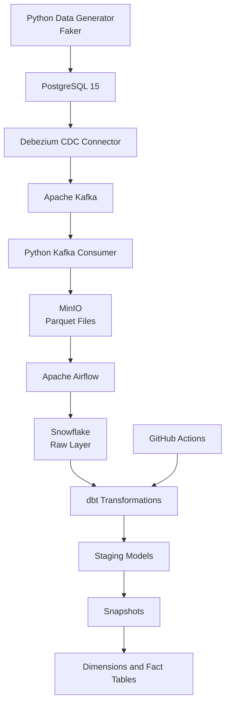

# Real-Time-End-to-End_Data_Pipeline-Using-Kafka-Airflow-DBT-Snowflake

## End-to-End Banking Data Engineering Pipeline

An end-to-end data engineering project that demonstrates how banking data can be captured, processed, stored, and transformed using a modern data stack built around **PostgreSQL, Apache Kafka, Debezium, MinIO, Apache Airflow, dbt, and Snowflake**.

The pipeline uses Change Data Capture (CDC) to capture database changes and Kafka to transport event data. It uses MinIO for object storage, Airflow for workflow orchestration, and dbt for transforming raw banking data into analytics-ready models in Snowflake.

## Project Overview

Banking platforms generate different types of data, including customer information, account details, and financial transactions. Moving this data into an analytical environment requires a structured approach to data ingestion, processing, storage, and transformation.

This project demonstrates a CDC-based architecture that brings these components together. It uses synthetic banking data to illustrate how data moves from a transactional PostgreSQL database through an event-streaming layer and object storage before reaching a cloud data warehouse.

The implementation focuses on:

- Capturing database changes using Debezium and PostgreSQL logical replication.
- Streaming change events through Apache Kafka.
- Processing events and storing data in Parquet format in MinIO.
- Orchestrating ingestion and transformation workflows with Apache Airflow.
- Building analytical data models using dbt and Snowflake.
- Automating dbt workflows through GitHub Actions.

## Architecture



## Technology Stack

| Component | Technology | Purpose |
|---|---|---|
| Programming | Python | Data generation and event processing |
| Source Database | PostgreSQL 15 | Stores customer, account, and transaction data |
| CDC | Debezium | Captures database changes |
| Event Streaming | Apache Kafka | Transports CDC events |
| Object Storage | MinIO | Stores processed data in Parquet format |
| Workflow Orchestration | Apache Airflow | Schedules and manages data workflows |
| Cloud Data Warehouse | Snowflake | Stores analytical data |
| Data Transformation | dbt | Builds staging, snapshot, dimension, and fact models |
| Containerization | Docker, Docker Compose | Runs the core infrastructure |
| CI/CD | GitHub Actions | Automates configured dbt workflows |
| Synthetic Data | Faker | Generates sample banking records |

## Data Pipeline Implementation

### 1. Source Data Generation

Python and the Faker library are used to generate synthetic banking data.

The project works with three primary entities:

- **Customers:** Customer identifiers and personal details.
- **Accounts:** Account identifiers and associated customer information.
- **Transactions:** Transaction identifiers, account references, amounts, and transaction details.

The generated records are inserted into PostgreSQL, which acts as the transactional source database.

### 2. Change Data Capture with Debezium

Debezium is configured with the PostgreSQL connector to capture database changes through PostgreSQL logical replication.

The connector uses the `pgoutput` logical decoding plugin to identify changes made to the source tables.

Captured change events are published to Apache Kafka topics, providing a structured way to move database changes into the downstream processing layer.

### 3. Event Processing with Apache Kafka and Python

Apache Kafka acts as the event-streaming layer between PostgreSQL and the downstream storage system.

A Python-based Kafka consumer reads events from the configured topics and prepares the extracted records for storage.

The consumer uses a configurable batch threshold of 50 records per topic and writes the processed data in Parquet format.

This approach separates source database activity from downstream file storage and provides a foundation for scalable event processing.

### 4. Object Storage with MinIO

MinIO provides S3-compatible object storage for the processed data.

The Python consumer writes Parquet files to MinIO, creating an intermediate storage layer between Kafka and the analytical warehouse.

Parquet provides a columnar storage format that is suitable for analytical processing and helps organize data for downstream ingestion.

### 5. Workflow Orchestration with Apache Airflow

Apache Airflow manages the scheduled data workflows.

The project includes DAGs for:

- Loading data files from MinIO into Snowflake.
- Managing scheduled ingestion activities.
- Running daily snapshot and data transformation workflows.

The ingestion workflow uses Snowflake `PUT` and `COPY INTO` commands to transfer staged files into warehouse tables.

Airflow provides a centralized way to organize and schedule the pipeline's data processing tasks.

### 6. Data Transformation with dbt and Snowflake

Snowflake serves as the analytical data warehouse, while dbt manages the transformation layer.

The dbt project follows a structured modelling approach.

**Staging Models**

The staging layer includes:

- `stg_customers`
- `stg_accounts`
- `stg_transactions`

These models prepare the source data for analytical use by extracting relevant fields, applying data transformations, and handling duplicate records.

**Snapshots**

The project uses dbt snapshots with a check-based strategy to track changes in customer and account records over time.

This supports historical tracking and provides a foundation for Slowly Changing Dimension (SCD) Type 2 modelling.

**Dimension Models**

The project builds:

- `dim_customers`
- `dim_accounts`

These models provide structured customer and account information for analytical queries.

**Fact Model**

The `fact_transactions` model is designed to represent transaction-level business data.

It uses transaction and account information to associate transactions with their corresponding customers, supporting downstream analytical use cases.

## Data Modelling Approach

The project follows a layered transformation approach:

| Layer | Description |
|---|---|
| Source | Banking records generated and stored in PostgreSQL |
| CDC and Streaming | Database changes captured by Debezium and transported through Kafka |
| Object Storage | Processed records stored as Parquet files in MinIO |
| Raw | Source data loaded into Snowflake |
| Staging | Data extraction, standardization, and deduplication using dbt |
| Snapshot | Historical tracking of customer and account changes |
| Dimension | Customer and account analytical models |
| Fact | Transaction-level analytical model |

## CI/CD with GitHub Actions

GitHub Actions is included to automate configured dbt workflows.

The repository contains workflow definitions for:

- dbt project validation and compilation.
- Pull request-based workflow execution.
- Running dbt commands against Snowflake.
- Managing connection credentials through GitHub Secrets.

This provides a repeatable workflow for managing and executing dbt transformations.

## Repository Structure

```text
Real-Time-End-to-End_Data_Pipeline-Using-Kafka-Airflow-DBT-Snowflake/
│
├── .github/
│   └── workflows/
│
├── initial_phase/
│
├── banking_dbt/
│   ├── models/
│   ├── snapshots/
│   └── .dbt/
│
├── consumer/
│   └── kafka_to_minio.py
│
├── data-generator/
│   └── faker_generator.py
│
├── docker/
│   └── dags/
│
├── kafka-debezium/
│   └── generate_and_post_connector.py
│
├── postgres/
│   └── schema.sql
│
├── docker-compose.yml
├── dockerfile-airflow.dockerfile
├── requirements.txt
├── .gitignore
└── LICENSE
```

## Getting Started

### Prerequisites

Make sure the following tools are installed:

- Git
- Docker Desktop or Docker Engine
- Docker Compose
- Python 3.x
- A Snowflake account with the required database, schema, warehouse, and credentials

### 1. Clone the Repository

```bash
git clone https://github.com/Subhajit-Chowdhury/Real-Time-End-to-End_Data_Pipeline-Using-Kafka-Airflow-DBT-Snowflake.git

cd Real-Time-End-to-End_Data_Pipeline-Using-Kafka-Airflow-DBT-Snowflake
```

### 2. Start the Infrastructure

```bash
docker compose up -d --build
```

This starts the core services configured in Docker Compose, including PostgreSQL, Kafka, Kafka Connect, MinIO, and Airflow.

### 3. Set Up the Python Environment

```bash
python -m venv .venv
```

Activate the environment:

**Windows**
```bash
.venv\Scripts\activate
```

**Linux / macOS**
```bash
source .venv/bin/activate
```

Install dependencies:

```bash
pip install -r requirements.txt
```

### 4. Initialize the PostgreSQL Schema

```bash
docker compose cp ./postgres/schema.sql postgres:/tmp/schema.sql

docker compose exec postgres sh -c 'psql -U "$POSTGRES_USER" -d "$POSTGRES_DB" -f /tmp/schema.sql'
```

### 5. Configure the Debezium Connector

After Kafka Connect is available, register the PostgreSQL connector:

```bash
python kafka-debezium/generate_and_post_connector.py
```

### 6. Generate Banking Data

Run the data generator:

```bash
python data-generator/faker_generator.py --once
```

### 7. Start the Kafka Consumer

```bash
python consumer/kafka_to_minio.py
```

The consumer reads the configured Kafka topics and prepares Parquet batches for MinIO storage.

### 8. Configure Snowflake and dbt

Configure the Snowflake connection in the dbt profile located at:

```text
banking_dbt/.dbt/profiles.yml
```

Set the required Snowflake connection details and credentials for your environment.

Configure the corresponding Snowflake database, schema, warehouse, and staging objects before running the warehouse workflows.

## Key Learning Outcomes

This project brings together several important data engineering concepts:

- Building CDC-based data ingestion pipelines.
- Working with PostgreSQL logical replication and Debezium.
- Understanding Kafka topics and event-driven processing.
- Processing data with Python.
- Working with Parquet and S3-compatible object storage.
- Orchestrating data workflows using Apache Airflow.
- Loading data into Snowflake using `COPY INTO`.
- Implementing dbt staging, snapshots, dimensions, and fact models.
- Applying SCD Type 2 concepts for historical data tracking.
- Automating dbt workflows with GitHub Actions.
- Managing data infrastructure using Docker Compose.

## Acknowledgements

This project is my own implementation inspired by the banking modern data stack walkthrough created by **Jaya Chandra Kadiveti (Data with Jay)**.

Original project: [Banking Modern Data Stack](https://github.com/Jay61616/banking-modern-datastack)

Tutorial: [End-to-End Banking Data Engineering Project](https://youtu.be/uHiyZitmIS0?si=hqAe6HblkAVxzHHv)

Credit to the original creator for the learning reference and project inspiration.

## Author

**Subhajit Chowdhury**

Data Engineer | AWS Certified | Snowflake

- GitHub: [Subhajit-Chowdhury](https://github.com/Subhajit-Chowdhury)
- LinkedIn: [Connect with me](https://www.linkedin.com/in/subhajit-dataengineer/)

---

If you find this project useful, feel free to explore the repository and share your feedback.

**Thanks for visiting!**
